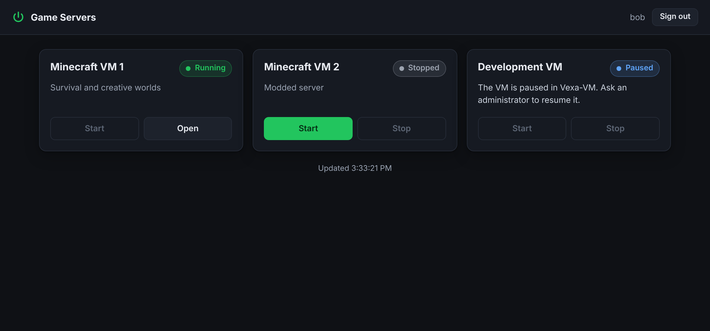

# vm-controller

A small, self-contained web application that lets authenticated users **start
and gracefully stop specific virtual machines** through the
[Vexa-VM](https://github.com/ItzGlace/vexa-vm) REST API, and nothing else.

It is not a hypervisor panel. Vexa-VM stays the place where VMs are managed;
vm-controller gives other people a narrow, permission-controlled "power
button" for the VMs you choose.



- One static Linux executable (no cgo); HTML, CSS and JavaScript are embedded.
- JSON configuration; SQLite only for password hashes and sessions.
- Single-user or multiuser mode, with per-user, per-VM permissions:
  `none`, `start` or `start-stop`.
- Only three Vexa operations exist in the code: read a VM, `start`, and
  graceful `shutdown`. Force-off, reboot, reset, suspend and everything
  else are impossible.
- Argon2id passwords, server-side sessions, CSRF tokens, Origin and
  Sec-Fetch-Site checks, login rate limiting, a strict Content Security
  Policy and other security headers.
- Designed to run behind Caddy, including as a fallback page for a service
  that lives inside one of the VMs.

---

## Contents

1. [How it works](#how-it-works)
2. [Building](#building)
3. [Installation on Debian](#installation-on-debian)
4. [Creating the Vexa-VM API key](#creating-the-vexa-vm-api-key)
5. [Configuration](#configuration)
6. [Managing users](#managing-users)
7. [Caddy](#caddy)
8. [How VM state is shown](#how-vm-state-is-shown)
9. [Security](#security)
10. [Troubleshooting](#troubleshooting)
11. [Development](#development)

---

## How it works

```text
browser ──HTTPS──▶ Caddy ──HTTP──▶ vm-controller (127.0.0.1:8090) ──API key──▶ Vexa-VM API
                                    │  login, sessions, CSRF
                                    │  per-user/per-VM authorization
                                    │  status cache, one request per VM at a time
                                    └─ SQLite: password hashes + sessions
```

Every request is authorized by vm-controller before anything is sent to
Vexa-VM. The browser never sees the API key and cannot reach Vexa through
the controller: there is no proxy. VM identifiers come only from the
validated configuration, and each Vexa URL is a fixed path built in code.

This matters because Vexa's `vms:power` scope is much broader than what
users get here. A key with that scope could force-off, reboot or reset any
VM; vm-controller exposes only `start` and `shutdown` for the VMs each user is
assigned.

## Building

You need Go **1.26 or newer** to build. The resulting binary needs nothing at
runtime: no Go, no libc version, no SQLite library.

```bash
cd vm-controller
make build                 # → dist/vm-controller for this machine
```

```bash
make release VERSION=v1.0.0   # → dist/vm-controller-linux-{amd64,arm64} + SHA256SUMS
```

Without make:

```bash
CGO_ENABLED=0 go build -trimpath -buildvcs=false -ldflags "-s -w -buildid= -X main.version=v1.0.0" -o dist/vm-controller ./cmd/vm-controller
```

**Reproducible builds.** The Makefile pins the toolchain (`GO_TOOLCHAIN ?=
go1.27.4`) and builds without cgo, without VCS stamping and with an empty build
ID. The same source, `VERSION` and toolchain give byte-identical binaries on
any machine and in any directory. Go downloads the pinned toolchain
automatically. To use the locally installed Go instead, run
`make build GO_TOOLCHAIN=local`.

**Debian 13 note.** Debian 13's `golang` package is Go 1.24, which is too old
for current dependency versions. Either let Go fetch a newer toolchain
(`GOTOOLCHAIN=auto`, the upstream default), or install Go from
<https://go.dev/dl/>. You can also build on any other machine and copy the
binary, since it is static.

## Installation on Debian

The steps below install the binary to `/usr/local/bin`, the configuration to
`/etc/vm-controller` and the database to `/var/lib/vm-controller`, and run
the service as an unprivileged `vm-controller` user.

1. Install the binary and create the service user:

   ```bash
   sudo install -m 0755 dist/vm-controller /usr/local/bin/vm-controller
   ```

   ```bash
   sudo useradd --system --home-dir /nonexistent --no-create-home --shell /usr/sbin/nologin vm-controller
   ```

2. Create the configuration directory and start from an example
   (`examples/config.single-user.json` or `examples/config.multiuser.json`):

   ```bash
   sudo install -d -m 0750 -o root -g vm-controller /etc/vm-controller
   ```

   ```bash
   sudo install -m 0640 -o root -g vm-controller examples/config.multiuser.json /etc/vm-controller/config.json
   ```

   ```bash
   sudoedit /etc/vm-controller/config.json
   ```

3. Store the Vexa API key ([how to create it](#creating-the-vexa-vm-api-key))
   in a file that only root and the service can read:

   ```bash
   sudo install -m 0640 -o root -g vm-controller /dev/null /etc/vm-controller/vexa-api-key
   ```

   ```bash
   sudoedit /etc/vm-controller/vexa-api-key
   ```

   The configuration then contains `"api_key_file": "/etc/vm-controller/vexa-api-key"`.
   vm-controller refuses to start if the file is readable by other users.

4. Create the state directory (systemd would also create it on first start,
   but the next step needs it already):

   ```bash
   sudo install -d -m 0700 -o vm-controller -g vm-controller /var/lib/vm-controller
   ```

5. Check the configuration, including that every VM is visible with the key:

   ```bash
   sudo -u vm-controller vm-controller check-config --online
   ```

6. Set a password for every user (you are prompted twice; nothing appears in
   the shell history or the process list):

   ```bash
   sudo -u vm-controller vm-controller user set-password alice
   ```

   Run user commands as `vm-controller`, not as root. As root they would
   create database files the service cannot write, so they refuse to run.

7. Install and start the systemd service:

   ```bash
   sudo install -m 0644 deploy/vm-controller.service /etc/systemd/system/vm-controller.service
   ```

   ```bash
   sudo systemctl daemon-reload
   ```

   ```bash
   sudo systemctl enable --now vm-controller
   ```

   ```bash
   journalctl -u vm-controller -f
   ```

   At startup the log lists every configured VM as found or not found in
   Vexa-VM, and warns about users that have no password yet.

8. Configure Caddy ([below](#caddy)) and reload it.

**Upgrading:** replace `/usr/local/bin/vm-controller` and run
`sudo systemctl restart vm-controller`. Configuration changes also need a
restart; there is no hot reload.

The unit in `deploy/vm-controller.service` applies systemd hardening:
`ProtectSystem=strict`, `PrivateUsers`, `NoNewPrivileges`, an empty
capability set, `MemoryDenyWriteExecute`, a `@system-service` syscall
filter, address-family restrictions and memory and task limits. Review it
with `systemd-analyze security vm-controller`.

## Creating the Vexa-VM API key

In the Vexa-VM panel, open **Settings → API keys → Create API key** and grant
only:

| Permission | Why |
|---|---|
| `vms:read` | Read the state of the configured VMs. |
| `vms:power` | Start and gracefully shut down VMs. |
| `jobs:read` | *Optional.* Only with `"track_jobs": true`, to notice failed power jobs immediately. |

If vm-controller runs on the Vexa host, also set the key's IP allowlist to
`127.0.0.1/32` (or `::1/128`). Vexa checks the allowlist against the socket
peer, so a stolen key would then be useless from elsewhere.

The same through the API (with an administrator session or a key that has
`api_keys:write`):

```http
POST /api/v1/api-keys
Content-Type: application/json

{"name": "vm-controller", "permissions": ["vms:read", "vms:power"], "ip_allowlist": ["127.0.0.1/32"]}
```

The secret (`vxa_…`) is shown only once, in the response.

## Configuration

The configuration is one JSON file. Its path is `--config PATH`, else
`$VM_CONTROLLER_CONFIG`, else `/etc/vm-controller/config.json`. It is
validated strictly at startup:

- unknown fields are rejected, so typos are caught;
- duplicate keys are rejected anywhere in the file;
- all problems are reported together, with their location.

Run `vm-controller check-config` after every edit.

Relative paths (`database`, `api_key_file`, `ca_file`) are resolved against
the directory of the configuration file.

### Top level

| Key | Default | Meaning |
|---|---|---|
| `mode` | *required* | `"single-user"` or `"multiuser"`. |
| `title` | `"VM Controller"` | Shown in the header and browser tab. |
| `listen` | `"127.0.0.1:8090"` | IP and port to listen on. Keep it on loopback behind Caddy. |
| `base_path` | `"/"` | URL prefix, e.g. `"/vmctl"`. All pages, API routes and the cookie live below it. |
| `database` | `"/var/lib/vm-controller/vm-controller.db"` | SQLite file (created with mode 0600). |
| `cookie_secure` | `"auto"` | `"auto"`: Secure cookie when the request arrived over HTTPS (directly, or `X-Forwarded-Proto: https` from a trusted proxy). `"always"` or `"never"` to force it. |
| `trusted_proxies` | `["127.0.0.0/8", "::1/128"]` | Peers whose `X-Forwarded-For`/`X-Forwarded-Proto` are believed. `[]` trusts nobody. |
| `session.lifetime_hours` | `12` | Absolute session lifetime (1–720). |
| `session.idle_timeout_minutes` | `120` | Sessions unused for this long expire (5 to the lifetime). |

### `vexa`

| Key | Default | Meaning |
|---|---|---|
| `base_url` | *required* | Vexa-VM URL, e.g. `"http://127.0.0.1:8080"` or `"https://vexa.example.com"`. No credentials, query or fragment. |
| `api_key_file` | | File containing the API key. Must not be accessible by "other" users. |
| `api_key_env` | `"VEXA_API_KEY"` | Environment variable with the API key; used when `api_key_file` is not set. |
| `ca_file` | | PEM file with an extra CA, for a Vexa node with a private certificate. |
| `allow_insecure_http` | `false` | Plain `http://` to a non-loopback host is refused unless this is `true`, because the key would travel unencrypted. |
| `timeout_seconds` | `10` | Timeout for each Vexa request. |
| `status_cache_seconds` | `5` | How long a VM's status is reused. All users share the cache, so Vexa sees at most one status request per VM per period. |
| `start_timeout_seconds` | `180` | How long "Starting…" is shown at most. |
| `stop_timeout_seconds` | `420` | How long "Stopping…" is shown at most. Keep it above 360; see [How VM state is shown](#how-vm-state-is-shown). |
| `track_jobs` | `false` | Also poll the Vexa job created by each request (needs `jobs:read`) to report failures immediately. |

### `vms`

| Key | Default | Meaning |
|---|---|---|
| `id` | *required* | The Vexa-VM identifier. Use the **UUID**: Vexa also accepts VM names, but a name can later refer to a different VM, so non-UUID ids produce a warning. |
| `name` | *required* | Name shown on the card. |
| `description` | | Optional second line on the card. |
| `allow_stop` | `false` | Global switch for graceful shutdown. When `false`, nobody can stop this VM and no Stop button is shown. |
| `url` | | Optional link shown as **Open** while the VM runs: an `http(s)://` URL or a path such as `"/"`. |

### Single-user mode

```json
{
  "mode": "single-user",
  "vexa": { "base_url": "http://127.0.0.1:8080", "api_key_file": "/etc/vm-controller/vexa-api-key" },
  "vms": [
    { "id": "3f1c9a2e-5b7d-4e8f-9a0b-1c2d3e4f5a61", "name": "Minecraft Game Servers", "allow_stop": false },
    { "id": "5a6b7c8d-9e0f-4a1b-8c2d-3e4f5a6b7c83", "name": "Development VM", "allow_stop": true },
    { "id": "0e1f2a3b-4c5d-4e6f-8a7b-9c0d1e2f3a94", "name": "Testing VM", "allow_stop": false }
  ],
  "single_user": { "username": "owner" }
}
```

The single user sees every VM, can start all of them and can stop exactly
those with `allow_stop: true`. A `users` section is ignored (with a warning).

### Multiuser mode

```json
{
  "mode": "multiuser",
  "vexa": { "base_url": "http://127.0.0.1:8080", "api_key_file": "/etc/vm-controller/vexa-api-key" },
  "vms": [
    { "id": "3f1c9a2e-5b7d-4e8f-9a0b-1c2d3e4f5a61", "name": "Minecraft VM 1", "allow_stop": false },
    { "id": "8d2e4b6a-1c3f-4a5b-8c7d-9e0f1a2b3c42", "name": "Minecraft VM 2", "allow_stop": true }
  ],
  "users": [
    { "username": "alice",   "permissions": { "3f1c9a2e-5b7d-4e8f-9a0b-1c2d3e4f5a61": "start" } },
    { "username": "bob",     "permissions": { "8d2e4b6a-1c3f-4a5b-8c7d-9e0f1a2b3c42": "start-stop" } },
    { "username": "charlie", "permissions": { "3f1c9a2e-5b7d-4e8f-9a0b-1c2d3e4f5a61": "start",
                                              "8d2e4b6a-1c3f-4a5b-8c7d-9e0f1a2b3c42": "start" } },
    { "username": "dave", "disabled": true, "permissions": {} }
  ]
}
```

| Permission | The user can |
|---|---|
| `none` (or absent) | Nothing. The VM is invisible; requests for it answer 404, as if it did not exist. |
| `start` | See the VM's state and start it. |
| `start-stop` | See the state, start it and request a graceful shutdown. Only valid for VMs with `allow_stop: true`; otherwise the configuration is rejected. |

Usernames are 1–64 characters: lowercase letters, digits, `.`, `_` and `-`.
Login is case-insensitive. A `single_user` section is ignored in this mode
(with a warning).

The JSON file decides who exists and what they may do. Removing a user or
setting `"disabled": true`, then restarting, revokes their access at once,
including open sessions. Narrowing a permission also applies to existing
sessions, because permissions are checked on every request.

## Managing users

There is no user administration in the web interface and no self-registration.

```text
vm-controller user set-password [--config PATH] [--stdin] USERNAME
vm-controller user list         [--config PATH]
vm-controller user revoke-sessions [--config PATH] USERNAME
vm-controller user remove       [--config PATH] USERNAME
```

- **set-password** prompts twice, with echo off. The user must exist in the
  configuration. Passwords need at least 12 characters. Setting a password
  signs out all of that user's sessions. For automation, `--stdin` reads one
  line from standard input instead of the terminal:
  `printf '%s\n' "$PW" | vm-controller user set-password --stdin alice`.
- **list** shows every configured user, whether a password is set, and the
  number of open sessions. It also lists stored passwords of users that are
  no longer in the configuration (they cannot sign in).
- **revoke-sessions** signs a user out everywhere.
- **remove** deletes a stored password and its sessions.

These commands work while the service is running, and take effect
immediately.

## Caddy

### On its own hostname

`deploy/Caddyfile.standalone`:

```caddy
vmctl.example.com {
	encode zstd gzip
	header Strict-Transport-Security "max-age=31536000"
	reverse_proxy 127.0.0.1:8090
}
```

Caddy terminates TLS and sets `X-Forwarded-For` and `X-Forwarded-Proto`. By
default it replaces any such headers sent by the client, so vm-controller can
believe them because they come from `127.0.0.1` (`trusted_proxies`). Do not
override the `Host` header in Caddy: the cross-origin check compares the
browser's `Origin` with it.

### As a fallback for a service inside a VM

Use case: `games.example.com` serves a game-server manager that runs inside a
VM. When that VM is stopped, visitors should get the controller instead, sign
in, and start the VM. When the manager answers again, Caddy should serve it
again.

`deploy/Caddyfile.fallback` (abridged):

```caddy
games.example.com {
	# The controller owns /vmctl/*; these requests never reach the manager.
	handle /vmctl* {
		reverse_proxy 127.0.0.1:8090
	}

	# Everything else is the manager inside the VM.
	handle {
		reverse_proxy 10.0.0.5:8080 {
			transport http {
				dial_timeout 3s
			}
			health_uri /api/v1/health
			health_interval 10s
			health_timeout 3s
			health_status 2xx
			flush_interval -1
		}
	}

	# When Caddy cannot reach the manager, send page loads to the controller.
	handle_errors {
		@manager_down {
			expression `{err.status_code} in [502, 503, 504]`
			method GET HEAD
			not path /vmctl*
		}
		handle @manager_down {
			redir * /vmctl/ 302
		}
		handle {
			respond "{err.status_code} {err.status_text}" {err.status_code}
		}
	}
}
```

For this, set `"base_path": "/vmctl"` in the controller's configuration, and
optionally `"url": "/"` on the manager's VM. That gives the card an **Open**
button back to the manager while the VM runs.

How it is isolated:

- `/vmctl*` always goes to the controller, and nothing else does. Its login,
  API and static files never collide with the manager's routes.
- The controller's session cookie has `Path=/vmctl`, so the manager never
  receives it.
- Only `GET`/`HEAD` page loads outside `/vmctl` are redirected. A failing API
  call from an open manager page gets a plain error instead of HTML.
- If the controller itself is down, `/vmctl/` returns 502 instead of
  redirecting to itself in a loop.

**How Caddy notices that the manager is down.**

- *Passive:* every request tries to connect. If the VM is off, the connection
  times out after `dial_timeout`. If the VM is up but the manager isn't
  listening, the connection is refused at once. Either way Caddy answers 502,
  `handle_errors` runs, and the browser is redirected.
- *Active (recommended):* `health_uri` probes the manager every
  `health_interval`. While it is marked unhealthy, Caddy answers 503
  immediately, without trying to connect, so the redirect is instant. Point
  `health_uri` at a cheap page of the manager; the Server Manager in this
  repository serves `/api/v1/health`.
- Only errors produced by Caddy trigger the fallback. If the manager is
  reachable but answers with its own 500 or 502 page, that page is shown.

**Limitations.**

- **Switching back takes time.** After the VM starts, Caddy serves the
  manager again only when the manager accepts connections and, with active
  checks, after its next successful probe (up to `health_interval` later).
  The guest OS and the manager need time to boot after Vexa reports the VM
  as running.
- **Users already on the fallback page stay there.** Caddy does not push
  anything to open pages, and the controller does not probe the manager. When
  the card shows **Running**, users click **Open** (or reload `/`). If the
  manager is not ready yet, Caddy simply sends them back to `/vmctl/`, which
  is harmless.
- **Users on the manager when the VM stops** keep their page until they
  navigate. Its background requests fail with 502/503 rather than being
  redirected. The next page load goes to the controller.
- **Vexa may report a stopped VM as running for a few minutes** (see below).
  During that time the fallback page shows **Running** and Start is disabled.
- **Same-origin hosting.** With the fallback on the same hostname, the
  manager and the controller share one browser origin. Each app receives the
  other's `Path=/` cookies, which the controller ignores and never logs.
  More importantly, a cross-site-scripting bug in the manager could make
  requests to `/vmctl/api/…` as the signed-in user. If that matters, put the
  controller on its own hostname (`Caddyfile.standalone`) and redirect there:
  `redir * https://vmctl.example.com/ 302`.

Both Caddyfiles were checked with `caddy validate` (Caddy v2.11.9). The
fallback behaviour was exercised locally: redirect while the manager is down,
switch back when it returns, no loop when the controller is down.

## How VM state is shown

A user always sees the buttons their permission allows (Start, and Stop only
with `start-stop` on a VM with `allow_stop: true`). Which of them is enabled
depends on the state:

| Card shows | Meaning | Enabled button |
|---|---|---|
| **Running** | Vexa reports `running`. | Stop |
| **Stopped** | Vexa reports `stopped`. | Start |
| **Starting…** / **Stopping…** | A request was accepted; waiting for Vexa to report the target state. | none |
| **Paused** | Paused in Vexa. Starting would resume it, which is an administrator decision, so it is refused. | none |
| **Busy** | Vexa is creating, reinstalling or migrating the VM. | none |
| **Error** / **Unknown** | Vexa reports an error or an unknown state. | none |
| **Unavailable** | Vexa could not be asked (down, timeout, rate limit, VM not found). | none |

Things worth knowing about Vexa-VM (0.1.9), all of which the controller
handles:

- **Power requests are asynchronous.** `start` and `shutdown` only queue a
  job (`202 Accepted`). The controller then shows *Starting…* or *Stopping…*
  until Vexa reports `running` or `stopped`, or until `start_timeout_seconds`
  or `stop_timeout_seconds` pass. After a timeout the card explains what
  happened, and a new attempt is possible.
- **`shutdown` is an ACPI request.** The guest decides whether and when to
  power off. A guest without ACPI handling (no `acpid`/`systemd-logind`, or
  Windows with the power button set to "do nothing") ignores it. After
  `stop_timeout_seconds` the card says so. vm-controller never escalates to
  force-off.
- **Vexa's stored state can lag.** `GET /api/v1/vms/{id}` returns the state
  stored in Vexa's database. It is refreshed right after each power job, and
  otherwise by a sweep every **5 minutes**. Directly after a graceful
  shutdown the guest is still running, so Vexa keeps reporting `running`
  until the next sweep. That is why `stop_timeout_seconds` defaults to 7
  minutes. It is also why a VM that shut itself down can appear as
  *Running*, with Start disabled, for up to 5 minutes.
- **Conflicting requests are refused.** Only one request per VM is processed
  at a time. Nothing new is accepted while one is pending, or within 5
  seconds of the previous one. The state is re-read from Vexa right before
  sending, so a VM that is already running is never "started" again.
- **Timeouts are not retried.** If Vexa does not answer a power request in
  time, the request may or may not have been applied. The user is told so
  and no automatic retry happens.
- **Pending states live in memory.** After a restart, cards simply show
  Vexa's state again.

## Security

- **Authorization on every request.** The configuration is resolved into a
  per-user, per-VM policy. Each API request checks the session, that the
  user is still active in the configuration, and the user's permission for
  that exact VM ID, all before anything is sent to Vexa. VMs the user may not
  see return 404, whether or not they exist. Stop is additionally refused by
  the controller layer for VMs with `allow_stop: false`. Tests send
  hand-crafted requests (other users' VMs, VMs known only to Vexa, encoded
  slashes, `..`, `force-off`, `reboot`, `/api/v1/...` paths, request bodies
  naming another action) and assert that the mock Vexa received no power
  call.
- **Vexa access.** The API key is read from a file or an environment
  variable, never from the JSON, and never appears in responses or logs.
  Requests go only to the configured base URL. Redirects are not followed
  (a redirect could carry the key elsewhere). Proxy environment variables
  are ignored. Responses are size-limited. Plain HTTP to a remote host
  requires an explicit opt-in.
- **Passwords.** Argon2id (64 MiB, 3 passes, 2 lanes), with at most two hashes
  computed at once. Unknown users, disabled users, users without a password
  and wrong passwords all get the same answer and take the same time. There
  are no default passwords.
- **Sessions.** 256-bit random tokens; only their SHA-256 is stored. Cookies
  are `HttpOnly`, `SameSite=Strict` and `Secure` on HTTPS, with a
  `__Host-`/`__Secure-` prefix. Sessions have an absolute lifetime and an
  idle timeout, are rotated on every login (no session fixation), and are
  capped at 10 per user. Logout, password changes and removing or disabling
  a user revoke them.
- **CSRF.** State-changing requests need the per-session `X-CSRF-Token`.
  Independently, cross-origin requests are rejected via `Sec-Fetch-Site` and
  `Origin`, using Go's `http.CrossOriginProtection`. Login also requires
  `Content-Type: application/json`, which a plain HTML form cannot send.
- **Brute force.** After 10 failed logins per client address (IPv6 grouped by
  /64) or 8 per account within 15 minutes, further attempts are refused for
  the rest of the window. This is checked before any hashing. Power requests
  are rate-limited per user.
- **XSS and framing.** No inline scripts or styles. The CSP is
  `default-src 'none'; script-src 'self'; …; frame-ancestors 'none'`. All
  dynamic text is inserted with `textContent`. `nosniff`, `DENY` framing and
  `no-referrer` are set. There is no CORS.
- **Forwarded headers.** These are believed only from `trusted_proxies`, and
  `X-Forwarded-For` is walked from the right, so a client cannot inject its
  own address.
- **Failing safely.** An invalid configuration, missing key or unreadable
  database stops the service at startup. A Vexa outage shows *Unavailable*
  and blocks all actions. Internal errors return generic messages, with the
  details only in the server log.
- **Files.** The database is created with mode 0600 in a 0700 directory, and
  the key file must not be world-readable.

## Troubleshooting

| Symptom | Cause and fix |
|---|---|
| Service does not start: `config …: …` | Fix the reported lines; `vm-controller check-config` lists every problem. |
| `vexa API key is missing` | `api_key_file` is empty or `api_key_env` is not set in the service environment. |
| `… is accessible by other users` | `sudo chmod 0640 /etc/vm-controller/vexa-api-key` (owner `root:vm-controller`). |
| `refusing to modify … as root` | Run user commands as the service user: `sudo -u vm-controller vm-controller user …`. |
| `attempt to write a readonly database` | A file in `/var/lib/vm-controller` belongs to root. Fix with `sudo chown -R vm-controller: /var/lib/vm-controller`. |
| Login always says "Invalid username or password." | Run `vm-controller user list`. Is a password set? Is the user active and in the configuration of the current `mode`? The journal shows `login failed` with the attempted username. |
| "Too many failed sign-in attempts" | Wait 15 minutes, or restart the service; the counters are in memory. |
| Signed in, but immediately signed out again | `cookie_secure: "always"` over plain HTTP, or Caddy is not passing `X-Forwarded-Proto` from a `trusted_proxies` address. Leave `cookie_secure` on `auto` behind Caddy. |
| "Cross-origin requests are not allowed." | The proxy rewrites the `Host` header (remove `header_up Host …`), or the page was opened under another hostname than it posts to. |
| Card shows *Unavailable* | Vexa is unreachable or rejects the key. Run `check-config --online`; the journal has the details. |
| "This VM was not found in Vexa-VM." | `vms[].id` is wrong. Copy the UUID from Vexa (`GET /api/v1/vms`, or the panel). |
| "Vexa-VM refused the controller's credentials." | The key lacks `vms:power`, has expired or was revoked, or its IP allowlist does not include the controller's address. |
| *Stopping…* for several minutes | Usually Vexa's 5-minute state refresh (see [above](#how-vm-state-is-shown)). If it ends with "the guest may have ignored the shutdown request", check ACPI handling in the guest. |
| Start is disabled although the VM is off | Vexa still reports `running`. Wait for its next refresh (at most 5 minutes). |
| Fallback: redirect loop | The `handle_errors` matcher must contain `not path /vmctl*`. |
| Fallback never triggers | `handle_errors` only sees Caddy's own 502/503/504. Check `dial_timeout` and the health check settings. |

The log goes to standard error, which means the journal under systemd. It
records logins, failed logins, denied requests, power requests (user, VM,
action, client address, Vexa job ID) and Vexa errors. It never records
passwords, password hashes, session tokens or the API key.

## Development

```bash
make test        # go test ./...
make test-race   # with the race detector (needs cgo)
make vet
```

The tests do not need a hypervisor. `internal/vexatest` is an in-memory
imitation of the parts of the Vexa API that are used, including the 202-job
semantics and the stale state after an ACPI shutdown. Try the whole
application locally:

```bash
go run ./cmd/mock-vexa -listen 127.0.0.1:8080 -api-key vxa_dev_only
```

```bash
VEXA_API_KEY=vxa_dev_only ./dist/vm-controller serve --config ./dev/config.json
```

Here `dev/config.json` is a copy of `examples/config.multiuser.json` with
`"database": "dev.db"`, and `"api_key_env": "VEXA_API_KEY"` instead of
`api_key_file`. The mock's default VMs use the UUIDs from that example.
Set passwords with
`printf 'a long password\n' | ./dist/vm-controller user set-password --config ./dev/config.json --stdin alice`.
`cmd/mock-vexa` is a development tool and not part of the release build.

### Layout

```text
cmd/vm-controller/   CLI: serve, check-config, user …
cmd/mock-vexa/       development-only mock of the Vexa-VM API
internal/config/     JSON schema, validation, per-user/per-VM policy, API key loading
internal/vexa/       the Vexa client: get VM, start, shutdown, get job — nothing else
internal/control/    status cache, pending start/stop tracking, conflict prevention
internal/auth/       Argon2id hashing, session tokens
internal/store/      SQLite: password hashes and sessions
internal/server/     HTTP routes, sessions, CSRF, origin checks, rate limits, headers
internal/vexatest/   in-memory Vexa API used by tests and mock-vexa
web/                 embedded index.html, CSS, JavaScript
deploy/              systemd unit, Caddyfiles
examples/            single-user and multiuser configurations
```

### HTTP API used by the frontend

All paths are below `base_path`. POST requests need the `X-CSRF-Token` header.

| Method | Path | |
|---|---|---|
| GET | `/api/session` | `{authenticated, username, csrf_token}` |
| POST | `/api/login` | `{"username", "password"}` → session cookie |
| POST | `/api/logout` | |
| GET | `/api/vms` | The user's VMs with state, permission and available actions |
| GET | `/api/vms/{id}` | One VM |
| POST | `/api/vms/{id}/start` | `202` when Vexa accepted the request |
| POST | `/api/vms/{id}/stop` | Graceful shutdown; `202` when accepted |
| GET | `/healthz` | `ok` (no authentication, no details) |
